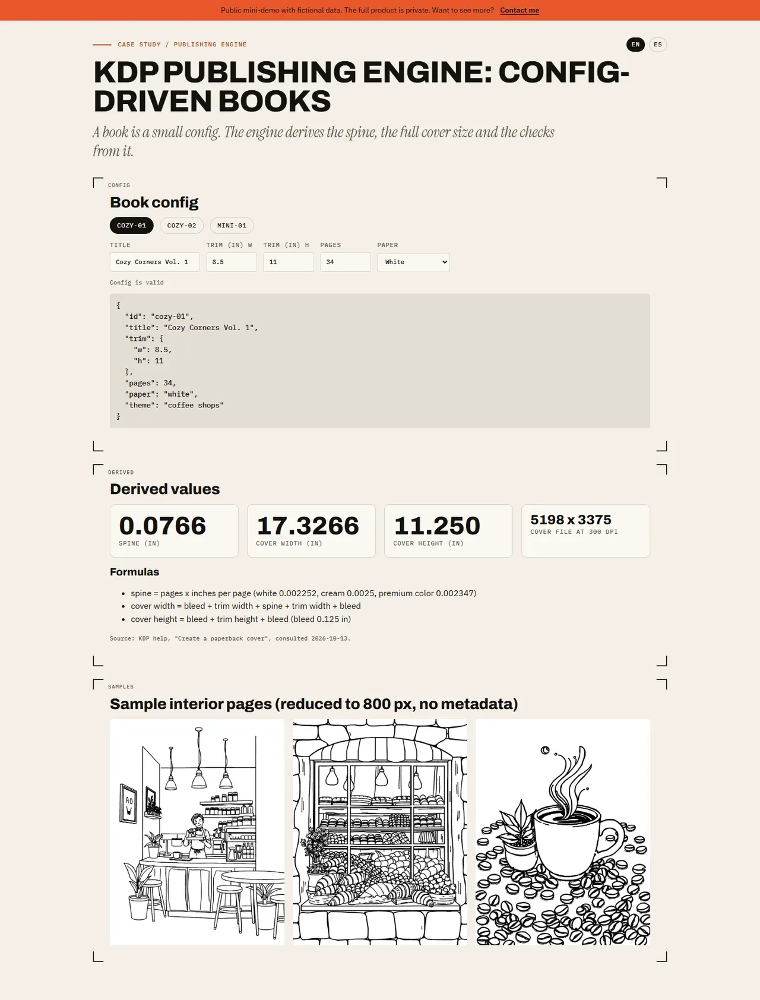

# KDP publishing engine — config-driven books

## Screenshots



> Public mini-demo with fictional data. The full product is private; access on request: carrerabernal@gmail.com

## Live demo

https://carrerable.github.io/kdp-engine-demo/

## What it demonstrates

- A book described as data (title, trim size, page count, paper) and the values the engine derives from it: spine width, full cover width and height, and the cover size in pixels at 300 dpi.
- Config validation (page count limits).
- Three sample interior pages from the real project, reduced to 800 px with all metadata removed.

## Formulas

- `spine = pages x inches per page` (white 0.002252, cream 0.0025, premium color 0.002347)
- `cover width = bleed + trim width + spine + trim width + bleed`
- `cover height = bleed + trim height + bleed` (bleed 0.125 in)

Source: KDP help article "Create a paperback cover" (https://kdp.amazon.com/en_US/help/topic/G201953020), consulted on 2026-10-13. Check it again before relying on the numbers for a real book.

## What is fictional and what is real

The three book configs are fictional. The sample pages are real illustrations from my own coloring-book project. The code is written from scratch; the full engine is private.

## Run locally

```bash
npm ci && npm run dev
```

Add `?lang=es` for Spanish.

## Tests

```bash
npm test
```

## How it was built

Code written with Claude Code under my specs and code review; I designed the behavior, wrote the acceptance tests and verified the result.

## Case study

https://carrerable.github.io/en/projects/kdp-engine/

## License

MIT (code). The sample pages are included only to illustrate the demo.
